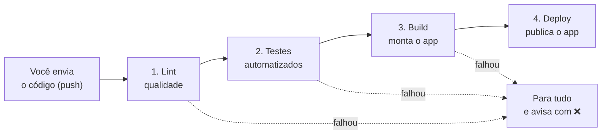

# CyberSafe (versão mobile)


App mobile (Ionic + Angular) de educação em cibersegurança, organizado em **trilhas de vídeos por faixa etária**. Este repositório também é a **demonstração prática de CI/CD** do seminário de Engenharia de Software 2 (UNIRIO).

**App publicado:** https://leonluz.github.io/CyberSafe/

> Este guia foi escrito para quem **nunca ouviu falar de CI/CD**. Não precisa saber nada de programação avançada para entender. Leia na ordem.

---

## Índice

1. [O que é CI/CD, em linguagem simples](#1-o-que-é-cicd-em-linguagem-simples)
2. [O pipeline do CyberSafe](#2-o-pipeline-do-cybersafe)
3. [Onde fica a "receita" do pipeline](#3-onde-fica-a-receita-do-pipeline)
4. [Como ver o pipeline funcionando](#4-como-ver-o-pipeline-funcionando)
5. [Como usar no dia a dia](#5-como-usar-no-dia-a-dia)
6. [Experimento guiado: quebrar e consertar](#6-experimento-guiado-quebrar-e-consertar)
7. [Como "postar" um vídeo novo](#7-como-postar-um-vídeo-novo)
8. [O que fazer quando aparece o ❌](#8-o-que-fazer-quando-aparece-o-)
9. [Problemas comuns](#9-problemas-comuns)
10. [Como o projeto está organizado](#10-como-o-projeto-está-organizado)
11. [Glossário](#11-glossário)

---

## 1. O que é CI/CD, em linguagem simples

### A analogia da fábrica de bolos

Imagine uma fábrica de bolos com vários cozinheiros. Cada um mexe em uma parte da receita.

**Sem automação:** no fim do dia, alguém junta tudo, prova o bolo e descobre que está salgado. Ninguém sabe quem errou nem em que momento. Corrigir dá muito trabalho.

**Com automação:** existe uma esteira. Toda vez que um cozinheiro muda a receita, a esteira **prova o bolo na hora**, confere a aparência, e só deixa o bolo ir para a vitrine se estiver perfeito. Se estiver ruim, a esteira **para e avisa** quem mexeu.

**CI/CD é essa esteira, só que para programas de computador.**

### O significado das siglas

| Sigla | Nome | O que significa na prática |
|---|---|---|
| **CI** | Integração Contínua | Toda vez que alguém envia código novo, o computador **confere automaticamente** se está tudo certo (qualidade, testes e se o app consegue ser montado). |
| **CD** | Entrega Contínua | Se a conferência passou, o computador **publica a nova versão sozinho**, sem ninguém fazer nada à mão. |
| **Pipeline** | "Cano" ou "esteira" | A sequência de etapas automáticas pela qual o código passa, uma depois da outra. |

### Por que isso é bom?

- **Erros aparecem na hora**, e não só quando o app já está pronto (ou, pior, na mão do usuário).
- **Ninguém esquece um passo**, porque o computador sempre faz tudo na mesma ordem.
- **Dá segurança para mexer no código.** Se algo quebrar, o pipeline avisa.
- **As entregas ficam rápidas.** Publicar uma versão nova vira só "enviar o código".

### Como era antes (deploy tradicional)

Antes, uma equipe escrevia o código e outra publicava, seguindo um "manual de deploy" cheio de passos manuais. Era fácil errar a ordem de um passo, por isso a publicação costumava acontecer em um dia marcado, e não toda hora. Com CI/CD, isso é substituído por etapas automáticas.

---

## 2. O pipeline do CyberSafe

Toda vez que alguém envia código para a branch `main` deste repositório, esta sequência acontece **sozinha**, na nuvem do GitHub:



### O que cada etapa faz

| Etapa | Nome simples | O que acontece | Ferramenta |
|---|---|---|---|
| **1. Lint** | "Corretor ortográfico do código" | Procura erros de escrita e de padrão no código, como variáveis sem uso ou trechos mal formatados. | ESLint |
| **2. Testes** | "Prova do bolo" | Roda pequenos programas que verificam se cada parte do app se comporta como esperado (ex.: "uma pessoa de 65 anos recebe a trilha de golpes financeiros"). | Vitest |
| **3. Build** | "Montar o produto final" | Transforma o código em um app pronto para usar. Se algo estiver quebrado, a montagem falha. | Angular CLI |
| **4. Deploy** | "Colocar na vitrine" | Publica o app na internet para qualquer pessoa acessar. | GitHub Pages |

**A regra de ouro:** cada etapa só começa se a anterior deu certo. **O deploy só acontece se lint, testes e build passarem.** Código com problema nunca chega ao app publicado.

### Ferramentas usadas

- **GitHub:** guarda o código (o "repositório").
- **GitHub Actions:** é a "esteira". Lê a receita do pipeline e executa tudo.
- **Ionic + Angular:** tecnologias com que o app foi feito.
- **Vitest:** executa os testes.
- **ESLint:** faz a análise de qualidade (lint).
- **GitHub Pages:** hospeda o app publicado.

---

## 3. Onde fica a "receita" do pipeline

O pipeline é descrito em dois arquivos de texto, dentro da pasta `.github/workflows/`:

```
.github/
└── workflows/
    ├── ci.yml        <- Integração Contínua (lint, testes e build)
    └── deploy.yml    <- Entrega Contínua (publica o app)
```

Esses arquivos são como uma **receita de bolo escrita para o computador**. O GitHub Actions lê a receita e executa os passos. Você não precisa instalar nada.

### `ci.yml` explicado em português

```yaml
on:
  push:
    branches: [ main ]       # QUANDO: sempre que alguém enviar código para a main
  pull_request:
    branches: [ main ]       # ...ou abrir um pedido para juntar código na main

jobs:
  lint:                      # TAREFA 1: conferir a qualidade do código
  test:                      # TAREFA 2: rodar os testes
    needs: lint              #   (só começa depois que a tarefa 1 passar)
  build:                     # TAREFA 3: montar o app
    needs: test              #   (só começa depois que a tarefa 2 passar)
```

Cada tarefa faz, mais ou menos, isto:

1. Pega uma máquina virtual limpa (Ubuntu) emprestada do GitHub.
2. Baixa o código do repositório.
3. Instala o Node.js e as dependências do projeto (`npm ci`).
4. Roda o comando da etapa (`npm run lint`, `npm test` ou `npm run build`).

Se algum comando terminar com erro, a tarefa **falha** e as seguintes **nem começam**.

### `deploy.yml` explicado em português

- **QUANDO roda:** assim que o `ci.yml` termina **com sucesso** na branch `main`. Também pode ser iniciado manualmente (botão **Run workflow**).
- **O QUE faz:** monta o app preparado para o endereço do GitHub Pages e publica no link do app.

Como o deploy depende do resultado do CI, **um teste quebrado impede a publicação**.

---

## 4. Como ver o pipeline funcionando

Você não "liga" o pipeline. Ele liga sozinho quando o código é enviado. Para **assistir**:

1. Abra o repositório no GitHub: https://github.com/leonluz/CyberSafe
2. Clique na aba **Actions** (na barra do topo, ao lado de "Pull requests").
3. Aparece uma lista com cada execução do pipeline, da mais recente para a mais antiga. Cada linha é um envio de código, com a mensagem do commit.
4. Clique em uma execução para ver as etapas (lint, testes, build) e, clicando em cada uma, **o que o computador fez passo a passo** (o "log").

### O que significam os símbolos

| Símbolo | Significado |
|---|---|
| 🟡 círculo amarelo girando | Está rodando agora. |
| ✅ verde | Passou. Está tudo certo. |
| ❌ vermelho | Falhou. Algo precisa ser corrigido (veja a seção 8). |
| ⚪ cinza | Foi pulado ou cancelado. Acontece com as etapas que dependiam de uma etapa que falhou. |

O **selo** no topo deste README (`CI`) também mostra o estado: verde "passing" quando o último envio passou, vermelho "failing" quando falhou.

---

## 5. Como usar no dia a dia

A rotina é sempre a mesma: **mexer, conferir, enviar, observar.**

### Preparação (só na primeira vez)

1. Instale o **Node.js** (versão 22): https://nodejs.org
2. Instale o **Git**: https://git-scm.com
3. Instale o **VS Code**: https://code.visualstudio.com
4. Baixe o projeto (clonar):
   ```bash
   git clone https://github.com/leonluz/CyberSafe.git
   cd CyberSafe
   ```
5. Instale as dependências do projeto:
   ```bash
   npm install
   ```

### A rotina de cada alteração

**Passo 1: faça a alteração** no código, pelo VS Code.

**Passo 2: (recomendado) rode as mesmas conferências no seu computador** antes de enviar. É como provar o bolo antes de mandar para a vitrine. No terminal do VS Code:

```bash
npm run lint              # etapa 1: qualidade do código
npm test -- --no-watch    # etapa 2: testes
npm run build             # etapa 3: monta o app
```

Se os três terminarem sem erro, o pipeline vai passar. Para ver o app no navegador: `npm start` e abrir http://localhost:4200

**Passo 3: faça o commit.** Um commit é um "pacote" de alterações com um nome. No VS Code:
1. Clique no ícone de ramificação à esquerda (**Source Control**), ou aperte `Ctrl+Shift+G`.
2. Escreva uma mensagem curta dizendo o que mudou (ex.: `feat: adiciona vídeo novo`).
3. Clique em **Commit**.

**Passo 4: envie para o GitHub.** Clique em **Sync Changes** (ou, no terminal, `git push`).

**Passo 5: observe.** Abra a aba **Actions** e veja o pipeline rodar. Se ficar tudo verde, em poucos minutos o app publicado já estará atualizado em https://leonluz.github.io/CyberSafe/

> Dica: se a página publicada parecer antiga, atualize com `Ctrl+F5`. O navegador guarda uma cópia para ser mais rápido.

---

## 6. Experimento guiado: quebrar e consertar

Esta é a melhor forma de **entender o pipeline na prática**. Vamos quebrar um teste de propósito, ver o pipeline barrar o erro e depois consertar.

### Parte A: quebrar

1. Abra o arquivo `src/app/modules/trilhas/trilhas.service.spec.ts`.
2. Encontre este teste:
   ```ts
   it('lista as 3 trilhas do CyberSafe', () => {
     expect(service.listar().length).toBe(3);
   });
   ```
3. Troque o `3` por `4` (agora o teste exige 4 trilhas, mas o app só tem 3):
   ```ts
   expect(service.listar().length).toBe(4);
   ```
4. Salve, faça o commit (mensagem: `teste: quebrando de propósito`) e envie (Sync Changes).

### Parte B: observar

1. Abra a aba **Actions**. Uma nova execução aparece.
2. A etapa **Lint** fica ✅.
3. A etapa **Testes** fica ❌. Clique nela e procure no log o nome do teste que falhou e a mensagem `expected 3 to be 4`.
4. A etapa **Build** fica ⚪ (nem começou).
5. **O deploy não acontece.** O app publicado continua na última versão boa. É isso que o CI/CD faz: **barra o erro antes de ele chegar ao usuário.**

### Parte C: consertar

1. Volte o `4` para `3`.
2. Commit (`teste: corrigindo`) e envio.
3. Na aba **Actions**, todas as etapas voltam a ficar ✅ e o deploy acontece.

---

## 7. Como "postar" um vídeo novo

Nesta versão beta não existe servidor nem painel de envio. Postar um vídeo são **três passos**, e o pipeline publica sozinho depois:

**1. Coloque o arquivo de vídeo** na pasta da trilha, dentro da pasta `assets/videos/` do projeto (que fica em `src/` ou em `public/`, conforme o `angular.json`):

```
assets/videos/jogos-digitais/video-1.mp4
assets/videos/seguranca-dados/video-1.mp4
assets/videos/golpes-financeiros/video-1.mp4
```

Use vídeos curtos, em formato **MP4**, com menos de 20 MB (o GitHub recusa arquivos acima de 100 MB).

**2. Registre o vídeo no catálogo**, no arquivo `src/app/modules/videos/videos.data.ts`, adicionando um bloco como este:

```ts
{
  id: 'gf-04',
  trilhaId: 'golpes-financeiros',
  titulo: 'Título do vídeo',
  descricao: 'Uma frase explicando o vídeo.',
  arquivo: 'video-4.mp4',
},
```

**3. Faça commit e envie.** O pipeline roda os testes e publica o app com o vídeo novo.

> Atenção: existe um teste que exige exatamente 3 vídeos por trilha (versão beta). Se você adicionar um 4º vídeo, atualize esse teste em `videos.service.spec.ts`, senão o pipeline vai falhar (o que, aliás, mostra o CI funcionando).

---

## 8. O que fazer quando aparece o ❌

Não entre em pânico: o ❌ não é um problema, é o pipeline **fazendo o trabalho dele**. Siga este roteiro:

1. Na aba **Actions**, clique na execução com ❌.
2. Veja **qual etapa** ficou vermelha:
   - **Lint:** erro de qualidade ou de escrita no código.
   - **Testes:** alguma parte do app não se comporta como o teste esperava.
   - **Build:** o app não conseguiu ser montado (em geral um erro de digitação no código).
3. Clique na etapa vermelha para abrir o **log**.
4. Procure as linhas em vermelho ou com a palavra `error` ou `FAIL`. Elas dizem **o arquivo e a linha** do problema.
5. Corrija no VS Code, rode `npm run lint`, `npm test -- --no-watch` e `npm run build` no seu computador, e envie de novo.

Se não entender a mensagem, copie o texto do erro e pergunte a alguém do grupo (ou a uma ferramenta de IA). Quase sempre a mensagem de erro basta para encontrar a solução.

---

## 9. Problemas comuns

**"Password authentication is not supported" ou "Authentication failed" ao enviar o código.**
O GitHub não aceita mais a senha da conta no Git. No Windows, abra o **Gerenciador de Credenciais**, remova os itens `git:https://github.com` e tente de novo (vai abrir o navegador para login). Outra opção é usar o GitHub CLI (`gh auth login`).

**"Updates were rejected because the remote contains work that you do not have locally".**
O GitHub tem alterações que você ainda não baixou. Rode `git pull` (ou, na primeira vez, `git pull origin main --allow-unrelated-histories --no-rebase --no-edit`), resolva conflitos se houver, e envie de novo. Nunca use `git push --force`, porque isso apaga o trabalho dos colegas.

**"remote origin already exists".**
Não é erro grave: o endereço do repositório já foi configurado. Confira com `git remote -v`.

**O deploy falha com "Get Pages site failed".**
O GitHub Pages ainda não está ligado. Vá em **Settings > Pages**, e em **Source** escolha **GitHub Actions**. Depois, na aba Actions, clique no deploy que falhou e em **Re-run all jobs**.

**O app publicado abre em branco ou com a página antiga.**
Aguarde 1 a 2 minutos após o deploy e atualize com `Ctrl+F5`.

**Os testes passam no meu computador e falham no GitHub (ou o contrário).**
Confira se você usa o Node.js 22 (`node -v`) e se rodou `npm ci` para instalar exatamente as versões do `package-lock.json`.

**O pipeline não rodou depois do meu envio.**
Os workflows só disparam para a branch `main`. Confira com `git branch` em qual branch você está.

---

## 10. Como o projeto está organizado

O app é dividido em **módulos**, cada um com uma responsabilidade e seus próprios testes. Isso ajuda o CI/CD: quando algo falha, o teste mostra exatamente qual módulo quebrou.

```
src/app/
├── core/models/          Definições dos dados (Trilha, Video)
├── modules/
│   ├── trilhas/          Regras das trilhas (qual trilha para cada idade)  + testes
│   ├── videos/           Catálogo e caminhos dos vídeos                    + testes
│   └── progresso/        Vídeos assistidos e percentual por trilha         + testes
└── pages/
    ├── home/             Tela inicial (lista de trilhas e sugestão por idade)
    ├── trilha/           Tela com os vídeos de uma trilha
    └── video/            Tela do player de vídeo
```

**As 3 trilhas do app:**

| Trilha | Público |
|---|---|
| Segurança em Jogos Digitais | Crianças e adolescentes (até 17 anos) |
| Segurança de Dados | Adultos (18 a 50 anos) |
| Golpes Financeiros | Pessoas com mais de 50 anos |

**Por que a organização modular combina com CI/CD?**

- **Isolamento de testes:** cada módulo tem seus próprios testes.
- **Validação individual:** o pipeline confere cada módulo de forma independente.
- **Garantia de regressão:** uma mudança em um módulo não é aceita sem provar que não quebrou os outros.
- **Produtividade em paralelo:** cada integrante pode cuidar de um módulo sem atrapalhar os demais.

---

## 11. Glossário

| Termo | Significado simples |
|---|---|
| **Repositório** | A "pasta na nuvem" onde o código do projeto fica guardado no GitHub. |
| **Commit** | Um "pacote" de alterações com um nome, que fica registrado no histórico. |
| **Push** | Enviar os commits do seu computador para o GitHub. |
| **Branch** | Uma "linha do tempo" do código. A principal se chama `main`. |
| **Pull request** | Um pedido para juntar o código de uma branch na `main`. |
| **Pipeline** | A sequência de etapas automáticas que o código percorre. |
| **GitHub Actions** | O serviço do GitHub que executa o pipeline. |
| **Workflow** | Um arquivo `.yml` com a "receita" do pipeline. |
| **Lint** | Verificação automática da qualidade e do padrão do código. |
| **Teste automatizado** | Programa que confere se outra parte do código funciona como esperado. |
| **Build** | Transformar o código em um app pronto para uso. |
| **Deploy** | Publicar o app para que as pessoas possam usá-lo. |
| **GitHub Pages** | Serviço gratuito do GitHub que hospeda a versão web do app. |
| **Log** | O "diário" do que o computador fez em cada etapa. Ótimo para achar erros. |
| **Node.js / npm** | Ferramentas para rodar e instalar as peças do projeto no computador. |

---

*Projeto acadêmico da disciplina de Engenharia de Software 2, UNIRIO. Tema do seminário: CI/CD.*
